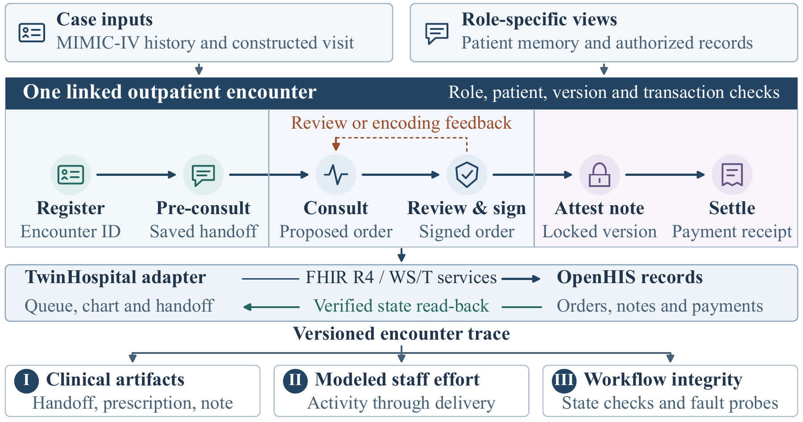

# TwinHospital

**Simulating Hospitals with Real HIS Data Flow**

TwinHospital simulates outpatient visits in OpenHIS. CAMEL coordinates patient and staff agents through consultation, prescription drafting and review, note signing, and simulated payment. Each visit produces a trace linking the agents' dialogue and decisions to records in the hospital system.

Each configuration starts from the same frozen case in an independent encounter. Retrieved handoffs, review feedback, and committed HIS records shape the next step. The archived cohort uses the native OpenHIS application APIs. New runs can select FHIR R4 workflow operations or a separate WS/T 846 SOAP service profile over the same OpenHIS connector. The WS/T profile identifies its national registration and order services separately from project workflow extensions. [Hospital interface and encounter state](handoff/HIS_INTERFACE.md)

[Run the same frozen assignments through both protocols](handoff/PROTOCOL_COMPARISON.md) · [Current DS/GLM model template](config/provider.ds-glm-20261111.example.json)

## Run the paper experiments with your data

Use the current checkout for the revised `outpatient-v2` workflows, together with OpenHIS 2.0.5 and your own cases or the fictional examples. Start with one case across three whole-visit configurations, then run all 27 combinations. The report follows Applications I–III: clinical artifacts, modeled role workload, and complete-encounter state checks. The v1 experiment kit preserves its original workflow snapshot.

[Experiment kit](https://github.com/Ricardo-Wang123/TwinHospital-Reproducibility/releases/tag/reader-experiments-v1) · [Experiment guide](handoff/REPRODUCE.md#4-run-a-paper-comparison) · [Case format](handoff/CASE_FORMAT.md) · [OpenHIS assets](https://github.com/Ricardo-Wang123/TwinHospital-Reproducibility/releases/tag/openhis-reader-v1)

## Data

The study combines MIMIC-IV v2.2 patient histories with constructed outpatient follow-ups. The archived native-interface cohort contains **170 encounters with simulated payment** from **10 development-set histories** across five diagnosis strata.

| Diagnosis stratum | Source histories | Encounters |
| --- | ---: | ---: |
| Type 2 diabetes | 2 | 35 |
| Heart failure | 2 | 33 |
| COPD | 2 | 35 |
| Pneumonia | 2 | 33 |
| Urinary tract infection | 2 | 34 |
| **Total** | **10** | **170** |

The case format shows how historical records, the patient's account, and findings from the simulated visit fit together. [Case format and examples](handoff/CASE_FORMAT.md) · [Encounter data summary](results/verified_paid_results_170.json)

## Framework

The clinical roles are the patient, physician, and pharmacist. Preconsultation, prescribing, and documentation AI tools are enabled by the selected configuration. The patient answers from its own case view; clinical staff use the available handoff, dialogue, and chart records. Prescription feedback returns to the physician for clarification or revision and then to the pharmacist for review. OpenHIS records the signed order, locked note, and simulated payment. Registration and payment use the adapter's corresponding HIS accounts.

## Experimental design

The current design crosses three configurations at each of three stages. Every prescribing condition receives the same pharmacist review before signing and simulated payment.

| Stage | Baseline | Assisted configurations |
| --- | --- | --- |
| Consultation | Direct physician consultation | AI intake with report reading before or during consultation |
| Prescribing | Physician prescription | AI draft followed by physician finalization; physician draft followed by AI advice and physician finalization |
| Documentation | Physician writing | Postencounter physician dictation or complete encounter transcript with a physician addendum, followed by AI drafting and physician finalization |

For physician dictation (C2), the physician selects and summarizes the completed encounter; the AI receives that summary and shared clinical records, without the raw dialogue. For transcript-based documentation (C3), the AI receives the actual physician–patient dialogue and the physician's postencounter addendum. Both assume accurate transcription and end with the treating physician's review and signature. Summary generation, supplementation, review and editing count toward physician workload. [Documentation workflows](handoff/REPRODUCE.md#documentation-inputs)

The 170 archived native-interface encounters use the original `legacy-v1` nurse-intake, rule-review and incremental-note conditions. Those traces record **140 of 170** handoffs requiring physician supplementation or correction, **14 of 141** initially approved prescriptions requiring encoding revision, and a **6.44-minute** median queue-to-payment time. These remain historical results, separate from the revised design. [Archived results and paper tables](results/README.md)

The study's case selection, approved access route, and frozen runtime are documented separately. [Study reproduction](handoff/REPRODUCE.md#repeat-the-study-configuration)
