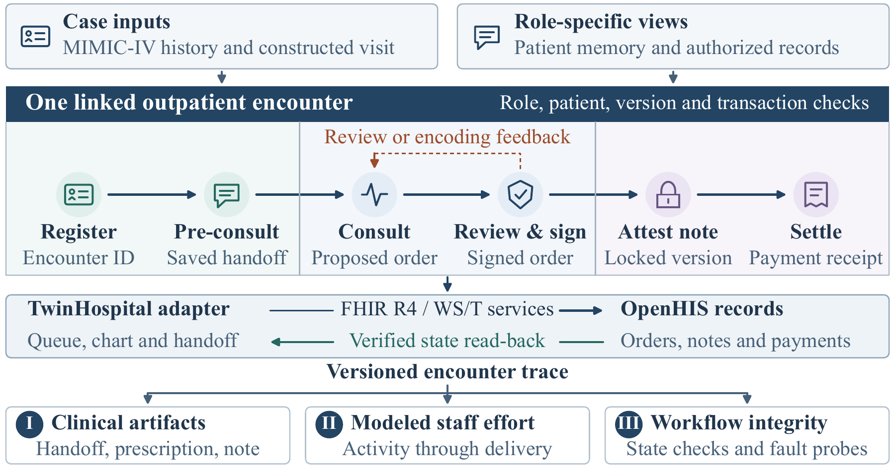

# TwinHospital

**Evaluating Clinical Language Agents through Linked Hospital Workflows**

TwinHospital simulates outpatient visits in OpenHIS. CAMEL coordinates patient and staff agents through intake, consultation, prescription review, note signing, and simulated payment. Each visit produces a trace linking the agents' dialogue and decisions to records in the hospital system.

## Data

The study combines MIMIC-IV v2.2 patient histories with constructed outpatient follow-ups. The reported cohort contains **170 encounters with simulated payment** from **10 development-set histories** across five diagnosis strata.

| Diagnosis stratum | Source histories | Encounters |
| --- | ---: | ---: |
| Type 2 diabetes | 2 | 35 |
| Heart failure | 2 | 33 |
| COPD | 2 | 35 |
| Pneumonia | 2 | 33 |
| Urinary tract infection | 2 | 34 |
| **Total** | **10** | **170** |

The case format shows how historical records, the patient's account, and findings from the simulated visit fit together. [Case format and examples](handoff/CASE_FORMAT.md) · [Encounter data summary](results/verified_paid_results_170.json)

## Framework

The patient agent answers from its own case view. Clinical roles use the handoff, dialogue, and chart records available to them. When an order is revised, the trace connects both versions to the same encounter. OpenHIS records the signed order, locked note, and simulated payment.

## Experimental design

The design crosses three configurations at each of three stages. All 27 combinations are represented in the reported cohort.

| Stage | Baseline | Assisted configurations |
| --- | --- | --- |
| Intake | Nurse agent | AI alone, or AI followed by nurse review |
| Prescription review | Rules with pharmacist routing | Rules with sequential or parallel AI and pharmacist review |
| Documentation | Physician agent | AI drafting during or after consultation |

The trace captures artifact revisions, staff actions used to model effort, and the resulting state in OpenHIS. Physician agents supplemented or corrected **140 of 170** handoffs. **14 of 141** prescriptions approved at first review needed revision for OpenHIS encoding. Median time from queue entry to simulated payment was **6.44 minutes**. [Study results and paper tables](results/README.md)

To run a visit with your own compatible model or reproduce the study configuration, see the [run guide](handoff/REPRODUCE.md).
